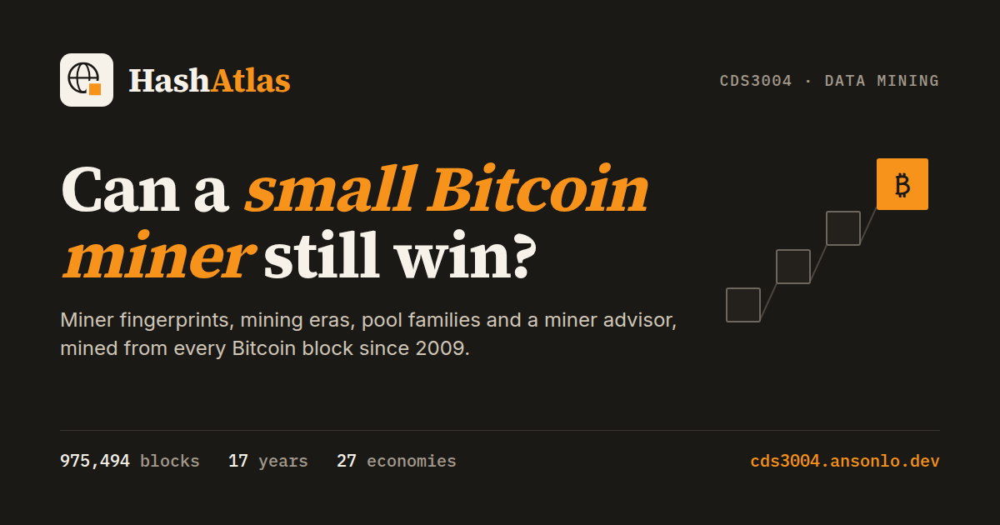
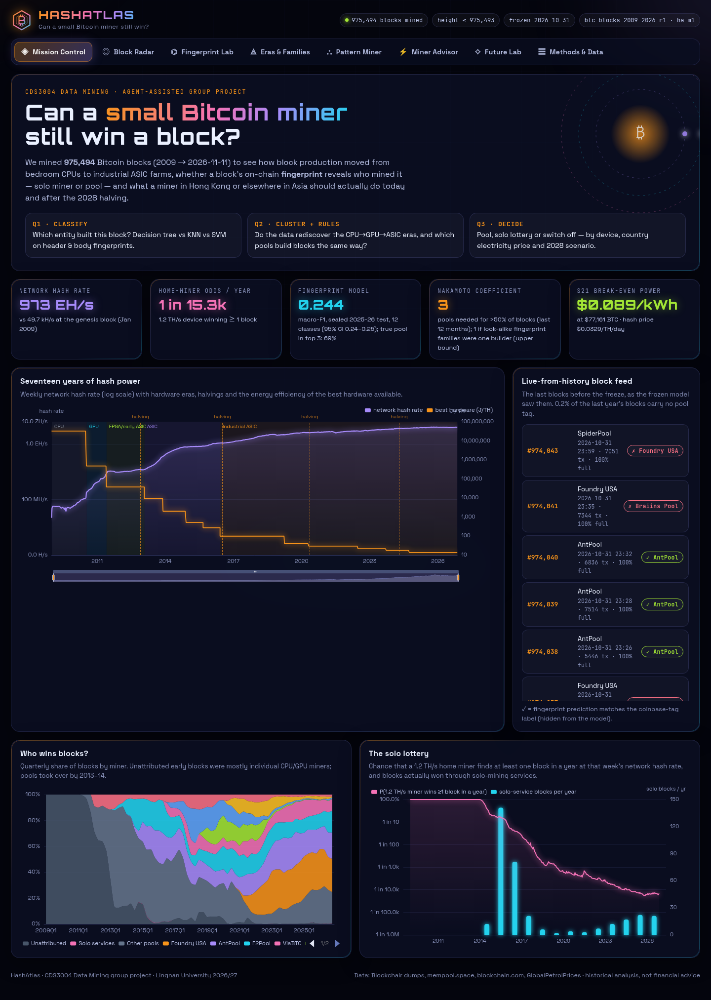
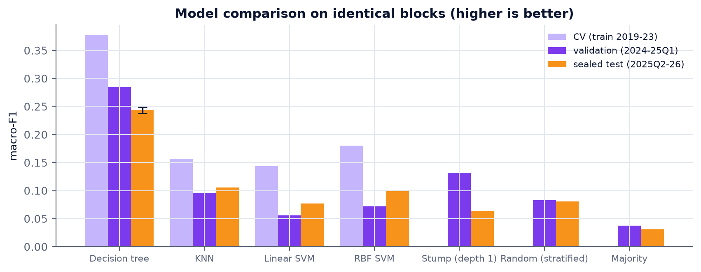
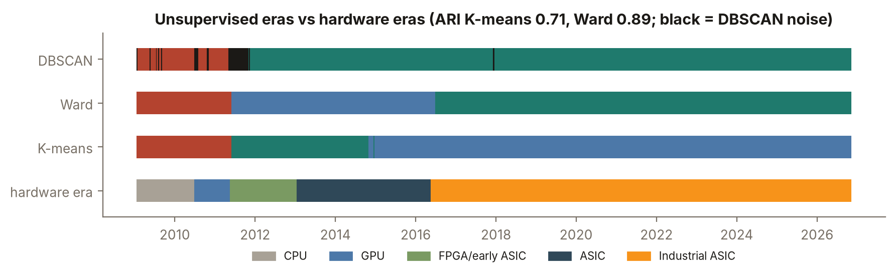

# HashAtlas: Can a Small Bitcoin Miner Still Win?

**Lingnan University · CDS3004 Data Mining · Group D · 26/27 Sem 1 · CRN 234**

[](https://cds3004.ansonlo.dev/)

**[Open the live dashboard](https://cds3004.ansonlo.dev/)** · [Research figures](#research-figures) · [Sample slides](#sample-slides) · [Project report](reports/technical_report.pdf) · [Reproduce the analysis](#reproduce)

HashAtlas uses 975,494 Bitcoin blocks to study how miners build blocks, how mining changed across hardware eras, and how electricity prices affect the choice to mine solo, join a pool, or switch off.

<details>
<summary>Play the animated project preview</summary>


</details>

## Dashboard demo

<a href="https://cds3004.ansonlo.dev/#/overview"></a>

The screenshot shows the deployed desktop Overview. Open the interactive views to [inspect post-freeze blocks](https://cds3004.ansonlo.dev/#/radar), [change a block's fingerprint](https://cds3004.ansonlo.dev/#/simulator), [compare mining costs across 27 economies](https://cds3004.ansonlo.dev/#/advisor), or [explore scenarios for the 2028 halving](https://cds3004.ansonlo.dev/#/future).

[More deployed screenshots, including mobile views](reports/screenshots/deployed)

## Research figures

### Can a block's behaviour identify its miner?

[](reports/figures/f07_model_comparison.png)

The models use block-construction features such as version bits, nonce bits and block fullness. The decision tree led KNN and the SVMs on the sealed out-of-time test after model selection with month-grouped and nested cross-validation.

### Do block patterns recover Bitcoin's mining eras?

[](reports/figures/f13_eras_timeline.png)

Weekly block patterns broadly recover the transition from hobbyist mining to industrial ASIC mining. The [pool dendrogram](reports/figures/f14_pool_dendrogram.png) and [Apriori rules](reports/figures/f15_rules.png) show which pools build similar blocks.

### Can a small miner cover electricity costs?

The [solo-mining odds](reports/figures/f03_solo_odds.png), [Miner Advisor results](reports/figures/f16_advisor.png) and [Future Lab scenarios](reports/figures/f17_future.png) put the chances of a block reward alongside electricity costs and the projected effects of the 2028 halving.

<!-- KEY RESULTS START -->
## Key results

|  | Result |
| :--- | :--- |
| Data | 975,494 blocks (heights 0-975,493), 0 missing / 0 duplicate heights; label precision 99.95% vs mempool.space |
| Fingerprint classifier (sealed test 2025-04 → 2026-10) | Decision tree: macro-F1 0.244 (95% CI 0.238-0.249), accuracy 42%, top-3 69%, template-family accuracy 46%; baselines ≤ 0.081 |
| Blocks mined after the freeze | 36.1% correct on 1,446 unseen blocks |
| Eras (unsupervised) | K-means K=3 ARI 0.71; Ward ARI 0.89 vs documented hardware eras |
| Association rules | 837 frequent itemsets from 120,538 blocks; 103 rules; brute-force check passed |
| Hong Kong miner advice | S21 loss 7.26 USD/day at 0.175 USD/kWh (break-even 0.089); 1.2 TH/s home miner: 1 in 16,362 per year |
| Future Lab | 2028 halving ~2028-04-07; backtest 80% band coverage 75% |
| Verification | 17/17 independent checks passed |
<!-- KEY RESULTS END -->

## Sample slides

| Slide | What it shows |
|---|---|
| [09 · How well does the tree identify a pool?][slide-09] | Sealed-test model comparison and top-three accuracy |
| [12 · Weekly block patterns reveal three mining eras][slide-12] | How Ward, K-means and DBSCAN compare with documented hardware eras |
| [15 · Should you mine in Hong Kong?][slide-15] | Break-even electricity prices and results for four mining devices |

[slide-09]: https://cdn.jsdelivr.net/gh/ansonlo-dev/HashAtlas@95ef55d700fd1513ae548be9bb5a32e92bef6b58/presentation/HashAtlas.pdf#page=9
[slide-12]: https://cdn.jsdelivr.net/gh/ansonlo-dev/HashAtlas@95ef55d700fd1513ae548be9bb5a32e92bef6b58/presentation/HashAtlas.pdf#page=12
[slide-15]: https://cdn.jsdelivr.net/gh/ansonlo-dev/HashAtlas@95ef55d700fd1513ae548be9bb5a32e92bef6b58/presentation/HashAtlas.pdf#page=15

[Full slide deck (PDF)](presentation/HashAtlas.pdf) · [PowerPoint](presentation/HashAtlas.pptx) · [Speaker script](presentation/slide_by_slide_script.md) · [90-second introduction video](presentation/video/hashatlas_intro.mp4)

## Project materials

| Material | Where |
|---|---|
| Technical report and individual contributions | [Report PDF](reports/technical_report.pdf), section 17 |
| Team membership and roles | [Team HashAtlas (five members)](configs/team.json) |
| Agent-use trajectories | [Per-member index](agent_trajectories/README.md) |
| Submission checklist and rubric map | [Submission guide](SUBMISSION.md) |

## Declaration of Use of AI-agent

We, LO Chi Kong, POON Tsz Chun, SUBEDI Anukaran, YE Xiaochen and LO Ka Hung, declare that generative artificial
intelligence (GAI) tools were used to prepare the submitted work for CDS3004 Data Mining at Lingnan University
(2026/27 Term 1), Group D’s HashAtlas group project.

**Tools and material incorporated.** Anthropic Claude Code helped explore project alternatives and generated
initial implementations for data acquisition and preparation, modelling and evaluation, and parts of the dashboard,
report and presentation. The project retains AI-generated and AI-revised code and text from this work. OpenAI Codex
assisted with revisions to the README, presentation and report, and drafted and integrated this declaration.
The introduction video on slide 2 uses Microsoft Edge neural text-to-speech (the `en-US-SteffanNeural` voice)
via `edge-tts` to synthesise narration from the video script.
[Claude Code](https://code.claude.com/docs/en/overview) · [OpenAI Codex](https://openai.com/codex/) · [Video narration source](presentation/video/README.md)

**Examples of instructions given.** We asked Claude Code to explore a Bitcoin project on solo mining, electricity
prices across economies and the GPU and ASIC eras, then to consider how much future analysis to include. We asked
Codex to revise the presentation while retaining its theme and to prepare the AI-use declaration using the
University’s GAI guidelines. These are paraphrases of project prompts.

**Review and responsibility.** The team chose the Bitcoin topic and takes responsibility for the research questions,
method choices, source attribution and conclusions. The project records corrections to agent-assisted work. For
example, we changed the data source when automated retries failed after the download quota was exhausted and
checked for missing block heights. We also revised the association-rule thresholds after an initial run returned
zero rules and tested the Future Lab method against historical data. The team is responsible for checking the
accuracy, possible bias and reuse rights of material retained from AI outputs.

The report gives further examples and verification evidence in §15. The trajectory index identifies where each
member’s own record of tools, prompts, responses and revisions belongs for the course submission.
[Technical report](reports/technical_report.pdf) · [Agent-use trajectory index](agent_trajectories/README.md) ·
[Lingnan University GAI Guidelines and Best Practices](https://www.ln.edu.hk/cital/generative-artificial-intelligence/gai-guidelines-best-practices)

## Requirements

- Linux or macOS; Python 3.12 managed by [uv](https://docs.astral.sh/uv/) (dependencies locked in `uv.lock`).
- For the PDF report: `pandoc` 3.x and TeX Live with `latexmk`, LuaLaTeX and the Libertinus fonts.
- For the dashboard: [Bun](https://bun.sh) (`web/`), and Node + a local Chrome for the browser check.
- For the slides: Node with `pptxgenjs` (`presentation/build`), LibreOffice for the PDF export.
- Internet access to `gz.blockchair.com`, `mempool.space`, `api.blockchain.info` and `globalpetrolprices.com`.

## Reproduce

```bash
uv sync                          # create the environment from uv.lock
uv run pytest -q                 # unit tests
uv run hashatlas acquire         # download (resumable; SHA-256 provenance in artifacts/source_manifest.json)
uv run hashatlas run-all         # clean → features → train → evaluate → explain → clusters → rules → decide
                                 # → future → figures → webdata → verify → report → notebook
cd web && bun install && bun test src && bun run validate-data && bun run build   # dashboard
node scripts/e2e.mjs             # bounded browser check, screenshots in reports/screenshots/
cd ../presentation/build && bun install && ./make.sh                              # slides + PDF
```

| Stage | What it does | Main outputs |
|---|---|---|
| `acquire` | Blockchair daily dumps (2009-2018), mempool.space per-pool block lists (2019+) and gap fill, pool definitions, solo-service lists, network charts, electricity prices | `data/raw/`, `artifacts/source_manifest.json` |
| `clean` | Typed loading of ~975k blocks, source merge, labels (mempool.space attribution / coinbase tags / address guess), label audit, quality report, data dictionary | `data/interim/blocks.parquet`, `artifacts/quality_report.json`, `artifacts/data_dictionary.csv` |
| `features` | Fingerprint features (bit decomposition, ratios, day-relative policy), weekly/day economics, hardware frontier, break-even prices | `data/processed/` |
| `train` | Feature selection (variance, MI vs noise probes, Spearman, group ablation), tree/KNN/SVM search with month-grouped CV, nested CV, template families, frozen model choice | `artifacts/feature_selection.json`, `model_search.json`, `model_selection.json`, `models/` |
| `evaluate` | Sealed-test metrics, confusion, ROC/PR, day-block bootstrap, drift, newcomer pools | `artifacts/test_metrics.json` |
| `explain` | Tree export, hand-checked Gini split, complexity curve, permutation importance, KNN neighbours, SVM coefficients | `artifacts/explanations.json` |
| `clusters` | Era discovery (K-means, 4 linkages, DBSCAN), pool families, anomalous blocks | `artifacts/clusters.json` |
| `rules` | From-scratch Apriori with brute-force check, rules, later-window confirmation, pool signatures, solo contrast | `artifacts/rules.json` |
| `decide` | Unknown-block attribution and concentration, post-freeze blocks, miner advisor | `artifacts/decisions.json` |
| `future` | Hash-rate scenario paths, halving timing, device break-even, backtest of two resampling windows | `artifacts/future.json` |
| `figures`, `webdata`, `verify`, `report`, `notebook` | Report/slide figures (white and paper-toned), dashboard data, independent checks, report PDF, executed notebook | `reports/`, `web/public/data/`, `artifacts/verification.json`, `notebooks/` |

**New examples:** `uv run hashatlas predict --heights 975400 975401` fingerprints blocks (prediction first, the
revealed label separately); `uv run hashatlas predict --ths 200 --watts 3500 --country "Hong Kong"` gives miner advice.

`data/` is regenerated and not committed; `artifacts/`, `models/`, `reports/` and `web/public/data/` are committed so
the evidence can be reviewed without rerunning.

## Repository layout

```
configs/            config.yaml (all settings), team.json (members and contributions)
src/hashatlas/      acquire, clean, features, train, evaluate, explain, clusters, rules, decide, future,
                    figures, webdata, verify, report, notebook, predict, cli
tests/              unit tests (bit decomposition, leakage, Apriori vs brute force, economics, bootstrap)
artifacts/          evidence files (JSON/CSV)        models/   fitted pipelines (joblib)
reports/            technical_report.{md,tex,pdf}, figures/, screenshots/, latex/
notebooks/          executed walkthrough notebook     web/      React + TypeScript + ECharts dashboard
presentation/       HashAtlas.pptx/.pdf, script, timing, build/  agent_trajectories/  per-member agent logs
```

## Data sources and terms

Blockchair daily dumps (free tier; cite Blockchair), mempool.space REST API and the open-source
[`mempool/mining-pools`](https://github.com/mempool/mining-pools) definitions, blockchain.com charts API,
GlobalPetrolPrices electricity price table (dated snapshot). Blocks are public, pseudonymous records; no personal data
is used. Outputs are historical analysis and scenarios, **not financial advice**.

## Version control

The history includes centrally reconstructed source checkpoints labelled with the stage owners in
`configs/team.json`. Their commit messages identify the original source versions and explain the date provenance.
The original development history is preserved in the local history package. Individual participation needs each
member's actual edits, reviews and exported agent sessions; the reconstructed checkpoints record assigned responsibility.

The [14 October–14 November timeline](docs/project_timeline_plan.md) distinguishes the team's recalled milestones
from the illustrative work plan. Reconstructed AuthorDate values refer to those milestones, with midnight as a
placeholder for unknown times; CommitDate records the actual reconstruction. Source snapshot dates remain in
the commit messages. These dates do not establish when a snapshot's individual files were written. Editorial
changes with known creation dates retain those AuthorDate values.
The dashboard is deployed with Cloudflare Workers (`web/wrangler.jsonc`) at <https://cds3004.ansonlo.dev/>.
