# 1. Introduction

In January 2009 anyone with a laptop could mine Bitcoin. Seventeen years later the network computes about
1,032 exahashes per second, block production is dominated by industrial pools, and yet every few
weeks a news story reports that a hobbyist with a single small device has "won the lottery" and mined a whole block
on their own. **Can a small miner still win?** And if you live in Hong Kong or elsewhere in Asia, what should you
actually do with a mining device: join a pool, mine solo as a lottery ticket, or switch it off?

This project answers these questions with data mining on the complete Bitcoin block history: **975,494
blocks** from the genesis block (3 January 2009) to height 975,493 (2026-11-11),
labelled with the entity that mined each one. We combine three complementary techniques, each matched to a question:

* **Classification** (decision tree, KNN, SVM): can the *behavioural fingerprint* a miner leaves in a block (version-bit
  rolling, nonce bits, timestamps, how the block is filled) reveal who mined it, without reading the miner's name?
* **Clustering** (K-means, four hierarchical linkages, DBSCAN): do the data rediscover the CPU → GPU → ASIC history of
  mining on their own, and which pools build their blocks in the same way?
* **Association rules** (Apriori, implemented from scratch): which block properties co-occur with which miners?

The models are then **applied to new examples**: blocks with no pool tag, blocks mined after our data freeze, and
miner set-ups in 27 economies. A limited **Future Lab** explores what the 2028 halving means for small miners, with a
backtest that shows how far such projections can be trusted. An interactive dashboard presents every result:
<https://cds3004.ansonlo.dev/>.

The rest of the report follows the course's six-step data-mining workflow: problem (section 2), design (3), data (4),
transformation and selection (5-6), mining and evaluation (7-10), decisions and interpretation (11-13), and
communication, ethics and agent use (14-16). Each member's contributions are listed in section 17.

# 2. Problem definition

## Users and decisions

* **A would-be home or small-business miner in Hong Kong or Asia** deciding whether a device is worth running, and how
  (pool or solo).
* **Analysts, journalists and regulators** asking how decentralised block production really is: a pool's *name* on a
  block does not say who built the block template.
* **Pool operators and researchers** who want to know which on-chain behaviours identify a miner (a privacy question).

## Questions and success criteria

| ID | Question | Technique | Success criterion (set before testing) |
|---|---|---|---|
| Q1 | From a block's fingerprint alone, which mining entity produced it? Can solo blocks be spotted? | Classification | Clearly beat majority / random / one-split baselines on an out-of-time test; report per-class results and the Solo class honestly |
| Q2a | Do the data rediscover the hardware eras without being told? | Clustering | Adjusted Rand index (ARI) against the documented eras clearly above 0; contiguous eras |
| Q2b | Which pools build blocks alike? | Clustering + rules | Families that are stable across linkages and consistent with the classifier's confusions |
| Q3 | What should a miner in Hong Kong / Asia do, now and after the 2028 halving? | Decisions on new examples | Advice that follows from the data, with explicit odds and break-even prices; future scenarios with a published backtest error |

## Constraints

1. **Labels are self-declared.** A block's miner is known only from the text a miner writes in the coinbase or from a
   known payout address. Labels can be missing ("Unknown"), copied or shared, and the label text itself must never
   be used as a model input (it would be leakage).
2. **No look-ahead.** Pools appear, merge and disappear over time, so evaluation must be out-of-time: train on the
   past, validate on the next period, test once on the most recent period.
3. **Extreme class imbalance.** Solo-mining services won only 349 blocks in history, about
   34 in the whole test period.
4. **Data access and scale.** Nearly a million blocks from free public sources with rate limits; the pipeline must
   resume, verify and record provenance. (The free Blockchair quota ran out mid-download; section 4 explains the switch.)
5. **Compute.** One workstation: SVM and nested cross-validation need bounded, documented samples.
6. **Ethics.** Public but pseudonymous data; no personal data; outputs must not be presented as investment advice.

## Alternatives considered

| Alternative | Why not chosen |
|---|---|
| Predict the BTC price | Not a data-mining question about mining; prices are driven by external events; widely shown to be unreliable |
| Identify pools by their coinbase tag | That is the *label*; a lookup table, not data mining, and fails exactly when a tag is absent or shared |
| Transaction-level analysis (address clustering) | Billions of rows; out of scope for one term and raises re-identification concerns |
| Deep learning on raw block bytes | Not interpretable, not taught in this course, and would hide *why* blocks are similar |
| Other crypto topics (Solana rug pulls, stablecoin de-pegs) | Considered at topic selection; Bitcoin mining offered the most complete, verifiable data across all three techniques |

# 3. Solution design

The design uses **three observation units**, one per question, so that each technique works on data whose meaning
fits it:

| Unit | Rows | Used for | Time meaning |
|---|---:|---|---|
| Block (2019-01 → 2026-11) | 419,035 | Fingerprint classification, association rules, anomalies | Each block is observed when mined |
| Week (2009 → 2026-10) | 926 | Era discovery (K-means, hierarchical, DBSCAN) | Weekly aggregate of all blocks |
| Pool profile (2024 → 2026-10) | 19 | Pool families (hierarchical) | Mean fingerprint of each pool |
| Device × economy | 212 | Miner advisor | Network state at the data freeze |

**Pipeline** (`uv run hashatlas run-all`, 15 stages): acquire → clean and label → features →
selection and training (frozen model choice) → sealed test → explanations → clustering → rules → decisions → Future
Lab → figures → web data → independent verification → report → notebook. Every stage writes its evidence to
`artifacts/` and is reproducible from `configs/config.yaml` (random seed 3004).

**What is new in this design.** (i) Fingerprints are learnt from *behaviour only*: the label source is excluded and the
version and nonce fields are decomposed into bits because they are nominal bit fields, not quantities. (ii)
Day-relative features remove market conditions so that only a miner's *policy* remains. (iii) Classification and
clustering are joined: "template families" found by hierarchical clustering on training data explain the classifier's
confusions and give a second, family-level evaluation. (iv) Decisions are made on genuinely new blocks mined *after*
the analysis freeze, and the Future Lab backtests its own method.

# 4. Data collection and preprocessing

## Sources and acquisition

| Source | Content | Size |
|---|---|---:|
| Blockchair daily block dumps | Every block 2009-2018 (one gzip TSV per day) | 551,030 rows |
| mempool.space API: per-pool block lists + gap fill | Every block from 1 Jan 2019 (height 556,459) to 2026-11-11, with mempool.space's pool attribution and fee-rate percentiles | 424,542 rows; 4,364 API calls |
| mempool.space mining-pool definitions (open source) | 172 pools, coinbase tags and payout addresses | 1 JSON |
| mempool.space solo-service block lists | 349 blocks of 6 solo services | 1 JSON |
| blockchain.com charts | Daily hash rate, price, miner revenue, fees since 2009 | 6,519 days |
| GlobalPetrolPrices (dated snapshot) | Household and business electricity prices, USD/kWh | 144 countries |

**Loading a large dataset.** The ~4,000 daily dump files are read in parallel with explicit dtypes and only the needed
columns, concatenated (about one million rows), de-duplicated by height and stored as Parquet. Every raw file has a
SHA-256 hash in `artifacts/source_manifest.json`; downloads resume and retry with back-off. Mid-way through, the free
Blockchair dump quota was exhausted (HTTP 402), so from 2019 onwards every block was fetched from mempool.space per
pool (100 blocks per call), and any isolated height missing from either source was filled individually. The final
table has **no missing and no duplicate heights** (0 to 975,493).

## Attribute types

Conceptual measurement scale is recorded separately from storage type (Lecture 2). Key decisions:

* `version` and `nonce` are stored as integers but are **nominal bit fields**: bit 13 being set says something about
  the miner's software; "version = 0x2FFFE000 is larger than 0x20000000" says nothing. They are decomposed into bits.
* `height` is ordinal (a position), `time` is interval, counts and sizes are ratio-scaled, `miner` is nominal.
* The full data dictionary with scale, discrete/continuous status and role is in `artifacts/data_dictionary.csv`
  (and the dashboard's Methods page).

## Data quality: problems found and how they were handled

| Issue | Finding | Handling |
|---|---|---|
| Missing values | Total input/output value and coin-days destroyed are not provided by mempool.space (424,464 rows) | Not used (not needed); fee rate recomputed where missing |
| Out-of-order timestamps | 16,279 blocks (1.67%) have an earlier timestamp than their predecessor | **Kept**: consensus allows it; it reflects miner clocks and is a candidate fingerprint, not an error |
| Empty blocks | 89,947 coinbase-only blocks | Kept; genuine miner behaviour (an empty-block flag is a feature) |
| Under-claimed rewards | 1,124 blocks claimed less than subsidy + fees (mostly 2011-2013 pool software); none claimed more | Kept; the subsidy is taken from the schedule, revenue from what was actually claimed |
| Difficulty consistency | Difficulty bits change only at retarget heights (0 violations) | Verified |
| Unattributed blocks | "Unknown" miner: 100% of blocks in 2010, 0.09% in 2024 | A genuine state, not a missing value: excluded from training, used as the application set (section 11) |
| Heavy tails / noise | Fees, transaction counts and sizes span orders of magnitude | log1p transforms; extremes are real (e.g. inscription-heavy blocks), so none deleted |

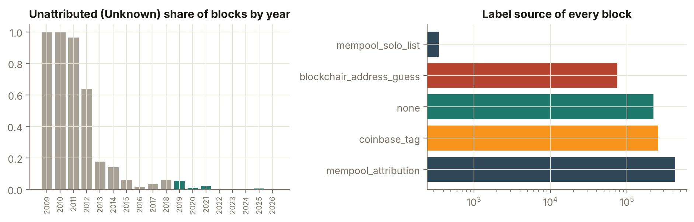

## Label quality audit

Labels for 2019+ come from mempool.space's attribution (coinbase tags *and* payout addresses, curated). Labels for
2009-2018 come from our own transparent labeller: the first matching coinbase tag from the same open definition
file, then Blockchair's address-based guess. To measure how good our labeller is, we **re-applied it to all
424,464 mempool.space-labelled blocks** and compared:

* when our labeller finds a tag, it agrees with mempool.space **99.95%** of the time;
* it finds a tag for 92.6% of blocks; the rest are mainly pools identified only by payout
  address (largest: F2Pool, 11,426 blocks), which our
  labeller marks Unknown rather than guessing;
* overall agreement 94.2%. Early-era labels are therefore precise but somewhat incomplete, which
  only affects descriptive statistics (section 9), not the 2019+ models.

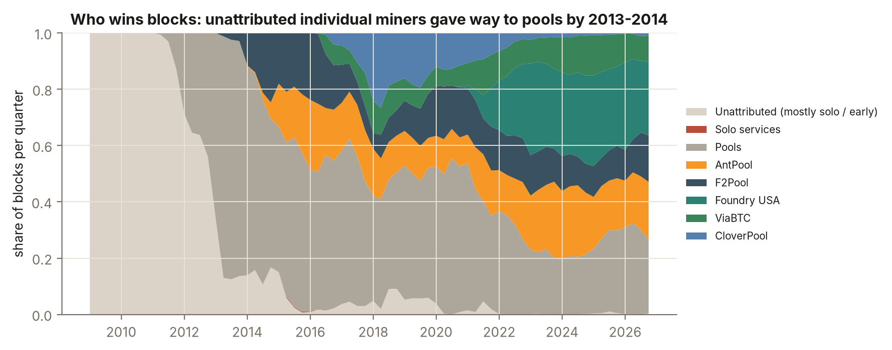

# 5. Feature transformation

All transformations are fitted on training data only where they have parameters (scaling, bins).

| Transformation | Applied to | Why |
|---|---|---|
| Bit decomposition | version bits 13-28 (BIP320 general-purpose bits used by ASICBoost rolling), count of rolled bits, BIP9 top bits, signal bits; nonce bits 0-31 | Nominal bit fields: each bit is a binary attribute; distances on the raw integer would be meaningless |
| log1p | transaction count, fees, fee rate, minimum fee rate, mean transaction size | Heavy right tails |
| Ratios and shares | fullness = weight / 4,000,000; witness share; fee share of reward; log(outputs) − log(inputs) | Comparable across eras and block sizes |
| **Day-relative policy** | fee rate, minimum/median fee, fee percentiles, transaction count, fullness, each minus the median of all blocks that day | Removes market conditions (busy vs quiet days) so that only the miner's template policy remains |
| Cyclic encoding | hour of day (sin, cos) | Included as a **deliberately irrelevant control**: blocks are found at random times, so selection should remove it |
| Standardisation | all features, inside the KNN and SVM pipelines (fitted per training fold) | Distance-based methods need comparable scales |
| Weekly aggregation | 9 era features (log hash rate, 30-day growth, empty share, transactions per block, fullness, fee share, unattributed share, HHI concentration, log BTC earned per TH/s) | Removes daily noise for era clustering |
| Frontier hardware and break-even price | best available J/TH by date (CPU → S21 XP); break-even USD/kWh = hash price ÷ energy per TH-day | Turns network data into the economics a miner faces |

**Excluded by design (leakage control):** coinbase text, payout address, Blockchair's miner guess (all label sources),
block height and calendar time (they only encode which pools were large *when*), and network difficulty (identical
for every miner in the same period). An automated check confirms none of them reached the model (section 15).

# 6. Feature selection

Feature selection used **training data only** (2019-2023, month-stratified sample of 60,001
blocks) and four complementary methods, from filter to wrapper:

| Step | Method | Removed | Remaining |
| ---: | :--- | :--- | ---: |
| 0 | Candidate fingerprint features | – | 77 |
| 1 | Variance filter (min-max scaled variance < 1e-4) | 0 | 77 |
| 2 | Mutual information vs. 10 random noise probes (cutoff 0.00019) | 19 | 58 |
| 3 | Redundancy: |Spearman ρ| > 0.90, keep higher MI | 2 | 56 |
| 4 | Wrapper: drop-one-group ablation (tree, month-grouped CV) | fee ladder (percentiles), hour of day (control) | 51 |

Findings worth noting:

* **Timing carries no miner signal.** Both timestamp features (offset from the median of the previous 11 blocks and
  interval since the previous block) scored below the noise probes and were removed, consistent with block discovery
  being a random (Poisson) process for every miner.
* **The control feature was caught**: the hour-of-day encodings were removed (one by mutual information, the other by
  the ablation), as designed.
* Most nonce bits are noise; a few low-order bits survive (some mining hardware searches the nonce space in a
  structured way).
* Redundant pair removed: log_fee_total vs log_fee_per_kwu (ρ = 0.929), rel_fee_p10 vs rel_fee_p25 (ρ = 0.912).

| Feature group | Features kept | CV macro-F1 without the group | Change |
| :--- | ---: | ---: | ---: |
| version bits | 20 | 0.3024 | -0.0400 |
| nonce bits | 17 | 0.3421 | -0.0003 |
| body composition | 10 | 0.2834 | -0.0590 |
| day-relative policy | 4 | 0.3389 | -0.0035 |
| fee ladder (percentiles) | 4 | 0.3434 | +0.0009 |
| hour of day (control) | 1 | 0.3426 | +0.0002 |

Version bits and body composition carry most of the signal. The final model uses **51 features**.

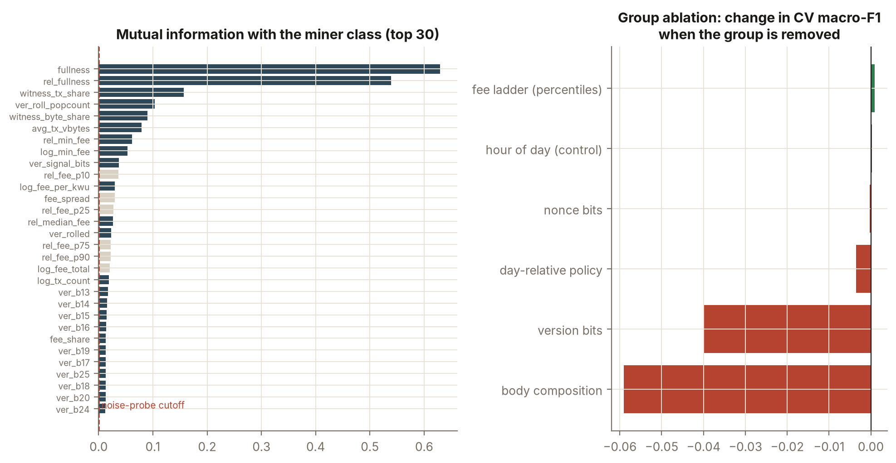

# 7. Model learning procedure

## Target and data splits

The target is the mining entity of a block: the 10 pools that mined at least 2% of training-period
blocks, an **Other pools** class, and a **Solo** class (the six solo-mining services). Unknown blocks are never used
for fitting.

| Split | Period | Labelled blocks | Solo | Role |
| :--- | :--- | ---: | ---: | :--- |
| Train | 2019-01-01 → 2023-12-31 | 262,327 | 28 | feature selection, hyper-parameters (CV), nested CV |
| Validation | 2024-01-01 → 2025-03-31 | 66,449 | 23 | model-family choice, Solo threshold (out of time) |
| Test (sealed) | 2025-04-01 → 2026-10-31 | 83,387 | 34 | scored once, after the choice was frozen |
| New | 2026-11-01 → 2026-11-11 | 1,446 | 3 | mined after the data freeze: decision demo |

**Cross-validation adapted to time.** Shuffled k-fold would put blocks from the same day in both training and
validation folds and overstate accuracy. Folds are therefore **grouped by calendar month** (5-fold GroupKFold). The
training sample keeps every Solo block and a month-stratified proportional sample of the rest (representative
sampling, Lecture 3).

## Algorithms and hyper-parameters

| Model | Grid searched | Chosen | CV macro-F1 (± SE) | Train macro-F1 |
| :--- | :--- | :--- | ---: | ---: |
| Decision tree | criterion {gini, entropy} × max_depth {3…16, none} × min_samples_leaf {5, 20, 50} × class_weight {none, balanced} | class_weight=balanced, criterion=gini, max_depth=12, min_samples_leaf=5 | 0.377 ± 0.009 | 0.458 |
| KNN | k {5, 15, 41} × weights {uniform, distance} × metric {Manhattan, Euclidean}; standardised | metric=euclidean, n_neighbors=41, weights=distance | 0.156 ± 0.003 | 1.000 |
| Linear SVM | C {0.01, 0.1, 1, 10}; balanced classes; 8,000-row sample | C=10.0 | 0.144 ± 0.006 | 0.176 |
| RBF SVM | C {1, 10} × γ {scale, 0.03}; balanced; 8,000-row sample | C=1.0, gamma=0.03 | 0.180 ± 0.003 | 0.539 |

The SVMs are trained on a bounded sample because kernel SVM cost grows roughly quadratically with rows; all models
are scored on identical validation and test blocks. **Nested cross-validation** (outer 5 × inner 3, month-grouped)
estimates the *whole* tree-tuning procedure without optimistic bias: macro-F1 **0.378 ± 0.021**
(SD over outer folds), close to the inner CV score, so the grid search did not overfit its own folds.

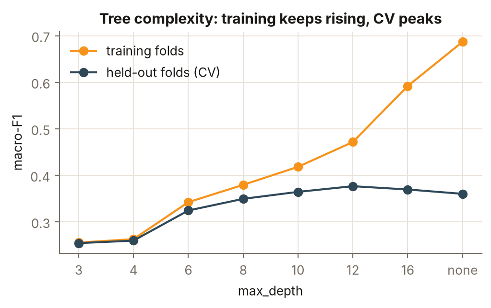

## How the tree splits (worked example)

The root of the training tree tests **`fullness` ≤ 0.998**. Recomputed by hand on
60,001 training blocks: parent Gini 0.8890; left child (50,210 blocks) Gini
0.8825; right child (9,791 blocks) Gini 0.4306; weighted child
impurity (n~L~G~L~ + n~R~G~R~)/n = 0.8088; **Gini reduction 0.0802**
(entropy information gain 0.3933). Gini and entropy reached CV scores of
0.377 and 0.373;
the chosen criterion was gini. The fitted tree is exported in full to the dashboard,
where any test block can be traced root-to-leaf.

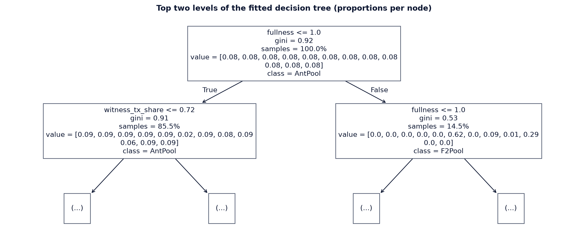

## Model choice (frozen before testing)

Rule declared in advance: highest **validation** macro-F1; the decision tree is preferred if within 0.01 (it is
explainable). Validation macro-F1: tree 0.285, KNN 0.096,
linear SVM 0.055, RBF SVM 0.072. The
operational model is the **decision tree**, frozen on 2026-11-13 03:39:30; the chosen configuration
was refitted on train + validation before the sealed test. The template families used for family-level scoring were
also fixed on training data: Binance Pool + F2Pool + Other pools + Poolin; Braiins Pool + ViaBTC.

# 8. Performance evaluation

## Results on the sealed test period

| Model | Macro-F1 | Balanced acc. | Accuracy | Top-3 acc. | Family acc. | Solo AP | Solo ROC-AUC |
| :--- | ---: | ---: | ---: | ---: | ---: | ---: | ---: |
| Decision tree **(operational)** | 0.244 | 26.8% | 42.4% | 68.9% | 45.6% | 0.009 | 0.645 |
| KNN | 0.105 | 12.7% | 28.7% | 65.8% | 31.7% | 0.001 | 0.499 |
| Linear SVM | 0.077 | 13.4% | 19.1% | 55.3% | 20.9% | 0.001 | 0.630 |
| RBF SVM | 0.099 | 12.7% | 27.4% | 67.9% | 31.7% | 0.001 | 0.573 |
| Decision stump (depth 1) | 0.063 | 12.1% | 17.4% | – | 24.9% | – | – |
| Stratified random | 0.081 | 9.8% | 12.6% | – | 25.8% | – | – |
| Majority class | 0.031 | 10.0% | 18.3% | – | 18.3% | – | – |

Test period 2025-04-01 → 2026-11-01, 83,387 labelled blocks, 12
classes. A 95% bootstrap interval that resamples whole **days** (blocks on the same day share conditions) gives
macro-F1 **0.238 – 0.249** for the operational model.
Macro-F1 is averaged over the classes present in the test period; predicting a pool that no longer exists still
counts as an error.

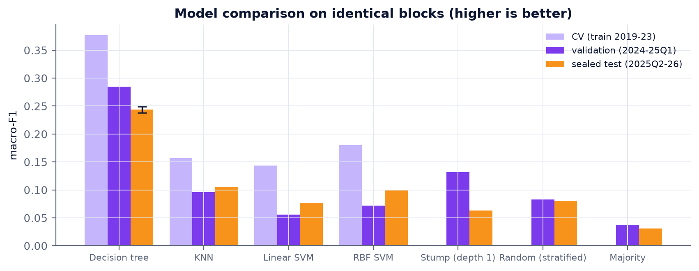

**Reading the numbers.** The decision tree is clearly the best model: its macro-F1 is
3.0× the stratified-random baseline and
3.9× a one-split tree. KNN and both SVMs also beat all three baselines, by smaller margins.
Exact-pool accuracy is modest (42% across 12 classes, against 18% for always
predicting the largest pool), but the **true pool is among the tree's top three candidates 69%** of
the time. In other words, behaviour narrows a block down to a few look-alike pools; it cannot reliably separate pools
that build blocks the same way. Merging the template families fixed on training data raises accuracy only to
46%, because those families were defined from average profiles, while the confusions below are
spread across many large pools.

**Why the tree and not KNN or SVM?** The signal sits in a few *discrete* bit patterns (signal bits set, how many
version bits are rolled) and in thresholds on block composition. Axis-aligned tree splits isolate exactly these
patterns. Distance- and kernel-based models weigh all 51 standardised features together, so a handful of
informative bits is drowned by many weakly informative ones (the curse of dimensionality discussed in Lecture 7). We
tested remedies on validation data — only the top-k mutual-information features, and mutual-information-weighted
distances — and neither lifted KNN or the RBF SVM above about 0.11 macro-F1. The model comparison therefore teaches
something about the data: its geometry favours rule-like models.

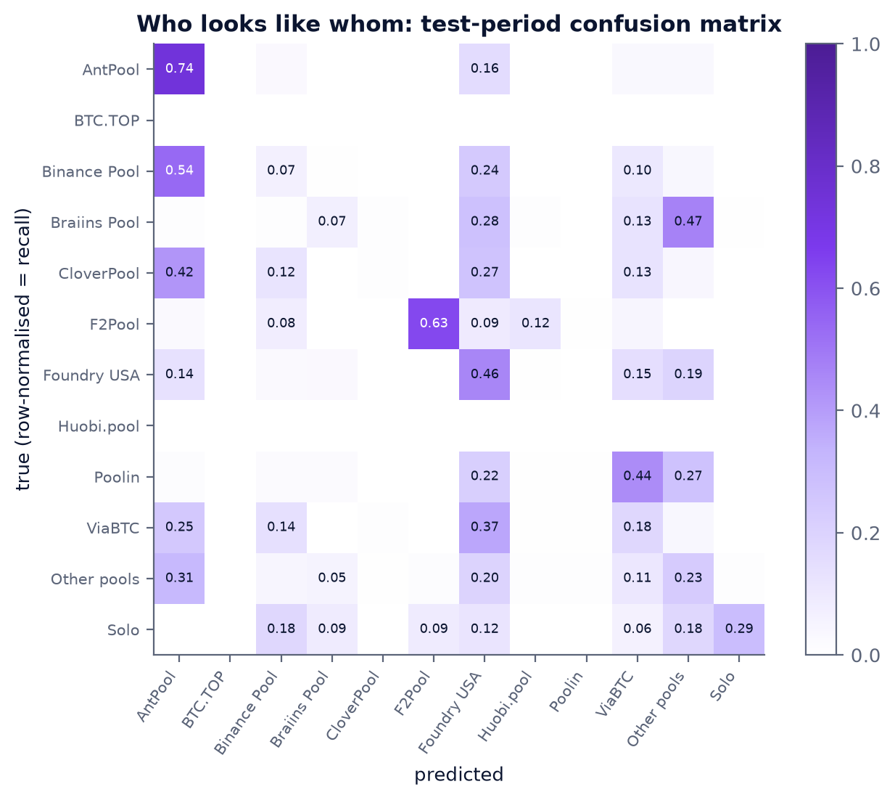

| Class | Precision | Recall | F1 | Blocks |
| :--- | ---: | ---: | ---: | ---: |
| AntPool | 0.45 | 0.74 | 0.56 | 15,241 |
| BTC.TOP | 0.00 | 0.00 | 0.00 | 0 |
| Binance Pool | 0.03 | 0.07 | 0.04 | 1,632 |
| Braiins Pool | 0.04 | 0.07 | 0.05 | 1,139 |
| CloverPool | 0.02 | 0.01 | 0.01 | 528 |
| F2Pool | 0.94 | 0.63 | 0.75 | 10,052 |
| Foundry USA | 0.48 | 0.46 | 0.47 | 23,960 |
| Huobi.pool | 0.00 | 0.00 | 0.00 | 0 |
| Poolin | 0.00 | 0.00 | 0.00 | 223 |
| ViaBTC | 0.18 | 0.18 | 0.18 | 8,944 |
| Other pools | 0.45 | 0.23 | 0.31 | 21,634 |
| Solo | 0.04 | 0.29 | 0.06 | 34 |

The validation-to-test difference and the monthly scores (dashboard, Block Radar) show **drift**: pools change firmware
and policies, and new pools appear. The pools that did not exist (or were small) during training are mapped by the
frozen model as follows, a direct test of "whose template does a newcomer use?":

| Newcomer pool | Blocks (val+test) | Most often predicted as | Share |
| :--- | ---: | :--- | ---: |
| SpiderPool | 8,518 | Foundry USA | 29% |
| MARA Pool | 6,940 | Other pools | 45% |
| SECPOOL | 4,876 | AntPool | 67% |
| Luxor | 4,443 | AntPool | 53% |
| SBI Crypto | 2,262 | Other pools | 66% |
| OCEAN | 1,666 | Solo | 18% |
| WhitePool | 960 | Foundry USA | 49% |
| Carbon Negative | 559 | Foundry USA | 50% |

## The Solo class

Solo blocks are a needle in a haystack (base rate 0.041% of test blocks). One-vs-rest
**average precision** is the honest metric here (ROC-AUC looks good for any rare class). The threshold frozen on
validation (highest recall with precision >= 0.5 on validation) flagged 282 test blocks, of which 10
were solo (precision 4%, recall 29% of 34). With so few
solo blocks per year these figures carry wide uncertainty; the finding is that **modern solo blocks are mostly built
with the same open-source templates as pool blocks** (section 10.3), so they are hard to fingerprint.

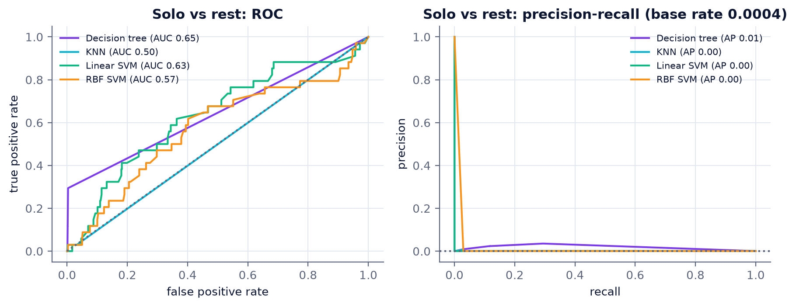

## What the models rely on

Permutation importance on the test period (drop in macro-F1 when one feature is shuffled):
`fullness` (0.1250), `rel_fullness` (0.0196), `log_min_fee` (0.0109), `fee_share` (0.0088), `log_fee_per_kwu` (0.0075), `witness_tx_share` (0.0061), `ver_roll_popcount` (0.0041), `witness_byte_share` (0.0019). Version-rolling bits and how full a block is relative
to that day dominate; fee features matter less because, since 2023, most pools fill blocks with the same fee-maximising
template (section 10).

**KNN, opened up.** For the latest solo test block (#973,413), the 41 nearest training blocks
(euclidean distance, distance weights, standardised features) voted
AntPool: 9, Foundry USA: 8, Binance Pool: 8, ViaBTC: 6, so KNN predicted **AntPool**,
a concrete illustration of why solo blocks are hard: their nearest neighbours are ordinary pool blocks.

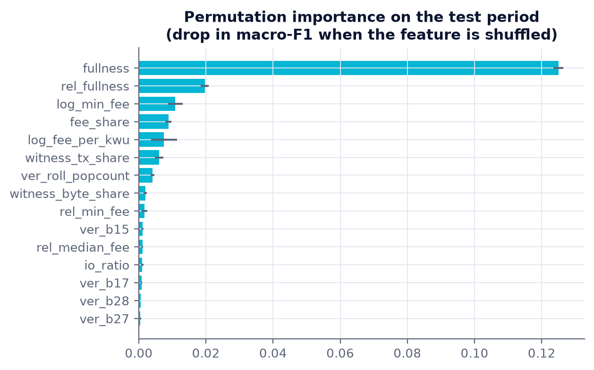

# 9. Clustering

## Rediscovering the mining eras

One row per week (926 weeks, 2009 → 2026), 9 standardised features describing *how* blocks
were produced. K was chosen by the silhouette maximum for K ≥ 3 (K = 2 trivially splits "early" from "late"); 25
initialisations; a hand-checked first iteration confirms the assignment and update steps (SSE
5,375.5 → 3,216.6, centroids identical to
scikit-learn within 2.8e-15). Stability across 10 seeds: mean ARI
0.93.

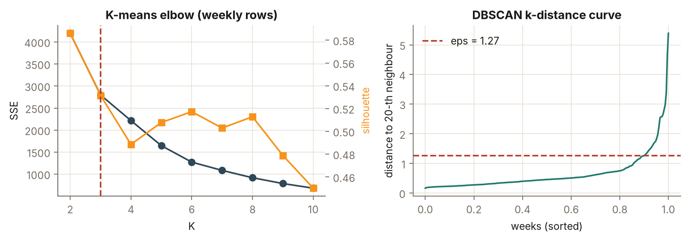

| Cluster | Weeks | From | To | Dominant documented era |
| :--- | ---: | :--- | :--- | :--- |
| C0 | 123 | 2009-02-02 | 2011-06-06 | CPU |
| C1 | 179 | 2011-06-13 | 2014-12-29 | ASIC |
| C2 | 624 | 2014-11-10 | 2026-10-26 | Industrial ASIC |

**Without being told anything about hardware, the clusters line up with the documented eras**: K-means ARI
**0.71**, Ward linkage ARI **0.89**. K-means places the start of the
industrial regime in 2014-11, when pools
had taken over and blocks had become full, rather than at the first ASIC in January 2013; Ward linkage's boundaries fall on
2011-06-13 and 2016-07-11, i.e. two weeks after the documented start of the FPGA era (1 June 2011) and two days after
the July 2016 halving that coincided with the industrial-ASIC (Antminer S9) era. Both are useful refinements
of a timeline that textbooks usually date by hardware releases alone.

| Linkage | Cophenetic correlation | Cluster sizes (cut at K) | ARI vs K-means | ARI vs eras |
| :--- | ---: | :--- | ---: | ---: |
| single | 0.882 | 921, 4, 1 | 0.02 | 0.01 |
| complete | 0.904 | 818, 103, 5 | 0.41 | 0.29 |
| average | 0.930 | 900, 21, 5 | 0.08 | 0.06 |
| ward | 0.808 | 538, 265, 123 | 0.71 | 0.89 |

Single linkage chains almost everything into one cluster (its known weakness); average linkage preserves distances best
(highest cophenetic correlation) but also produces one dominant cluster; **Ward**, which minimises the increase in SSE,
gives compact eras closest to history. **DBSCAN** (MinPts 20, eps
1.27 from the 0.9 quantile of the k-distance curve) finds
2 dense regions and labels 4.5% of weeks as noise: the
transition weeks where hash rate and block composition were changing fastest. Density-based clustering is the wrong
tool for separating eras that blend into each other, and that is itself a finding.

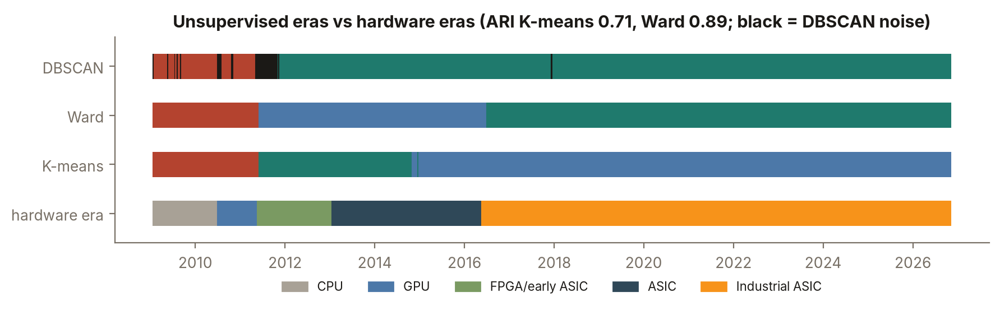

## Pool families

For the 19 pools with at least 300 blocks in 2024-01-01 → 2026-11-01,
a profile of mean fingerprints (version-rolling habits, signal bits, empty-block rate, day-relative fee and size policy,
timestamp offset) was clustered with average linkage (cophenetic correlation 0.858).
Cutting below the 35th percentile of merge heights gives these multi-pool families:
**AntPool + Braiins Pool + Foundry USA + Luxor**; **Binance Pool + CloverPool + Poolin**; **SECPOOL + ULTIMUSPOOL**.

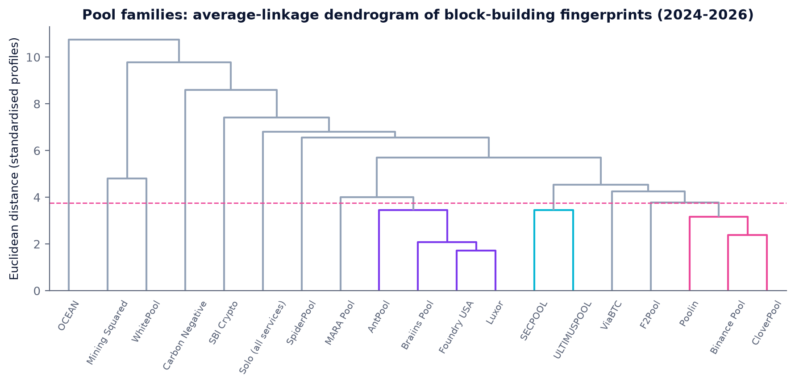

The families largely agree with the classifier: pools that are rare or absent in training are mostly read as an existing pool with a similar fingerprint (SECPOOL → AntPool 67%; Luxor → AntPool 53%; SBI Crypto → Other pools 66%; WhitePool → Foundry USA 49%), and Luxor is read as AntPool, which the dendrogram places in the same family. This matters for decentralisation: block production
that looks spread over many pool names may come from fewer distinct block-building set-ups. Similar fingerprints can
also come from shared mining firmware or pool software, so the data **suggest**, but do not prove, common control.

## Anomalous blocks

DBSCAN on 6,000 recent blocks marks 1.5% as noise. Those blocks are
65× more often empty than average and
have unusual timestamps, which is genuine but rare miner behaviour, not data errors.

# 10. Association rules

## Transactions, items and Apriori

Each modern block (2023-01-01 → 2025-04-01, **120,538 transactions**)
is a basket of 33 items: empty, full (≥ 98%) or light; how many version bits are rolled (none, 1-4, 5-8,
9-12, 13-16); signal bits set; timestamp far ahead of the median; fast or slow follow-up; fees and transaction count
below or above the day's median; witness-heavy content; consolidating or fan-out shape; and the miner (pools with at
least 1% of blocks, "small pools", Solo, Unknown). Bin edges were fitted on the discovery window only.

Apriori was implemented from scratch: join frequent (k−1)-itemsets sharing k−2 items, prune every candidate with an
infrequent subset (support is anti-monotone), then count the survivors.

| k | Joined candidates | Pruned by subset | Counted | Frequent |
| ---: | ---: | ---: | ---: | ---: |
| 1 | 33 | 0 | 33 | 30 |
| 2 | 435 | 0 | 435 | 170 |
| 3 | 1,082 | 531 | 551 | 345 |
| 4 | 1,158 | 765 | 393 | 292 |

Minimum support 1% (1,206 blocks) gave 837 frequent itemsets. An
exhaustive brute-force count of every itemset up to size 3 over 12
items found the same 40 frequent itemsets with identical counts
(**check passed**).

## Rules "block properties → miner"

With minimum confidence 30% (single pools have base rates of 1-30%, so this already implies
lift > 1), 103 rules were found, and each was re-measured on the later window 2025-04-01 → 2026-11-01.

| Rule | Support | Confidence | Lift | Later confidence | Confirmed |
| :--- | ---: | ---: | ---: | ---: | :--- |
| fullness=full(>=98%) ∧ version=signal bits set → SBI Crypto | 1.5% | 65% | 42.97 | 80% | yes |
| version=signal bits set → SBI Crypto | 1.5% | 61% | 40.63 | 85% | yes |
| fullness=full(>=98%) ∧ version=rolls 5-8 bits ∧ interval=fast(<60s) → Foundry USA | 1.3% | 39% | 1.29 | 36% | yes |
| version=rolls 5-8 bits ∧ interval=fast(<60s) → Foundry USA | 1.3% | 38% | 1.26 | 32% | no |
| version=rolls 5-8 bits ∧ interval=fast(<60s) ∧ fees=below-day-median → Foundry USA | 1.2% | 38% | 1.25 | 34% | no |
| version=rolls 5-8 bits ∧ txcount=below-day-median ∧ content=witness-heavy → Foundry USA | 1.9% | 37% | 1.23 | 34% | no |
| version=rolls 5-8 bits ∧ content=witness-heavy ∧ shape=consolidating → Foundry USA | 1.4% | 37% | 1.23 | 34% | yes |
| version=rolls 9-12 bits ∧ txcount=below-day-median ∧ shape=consolidating → Foundry USA | 1.1% | 37% | 1.22 | 31% | no |

Confidence is a historical conditional frequency and lift compares it with the miner's base rate; neither implies
causation. Most high-confidence rules point to the largest pool simply because of its base rate (low lift); the
informative rules are the high-lift ones.

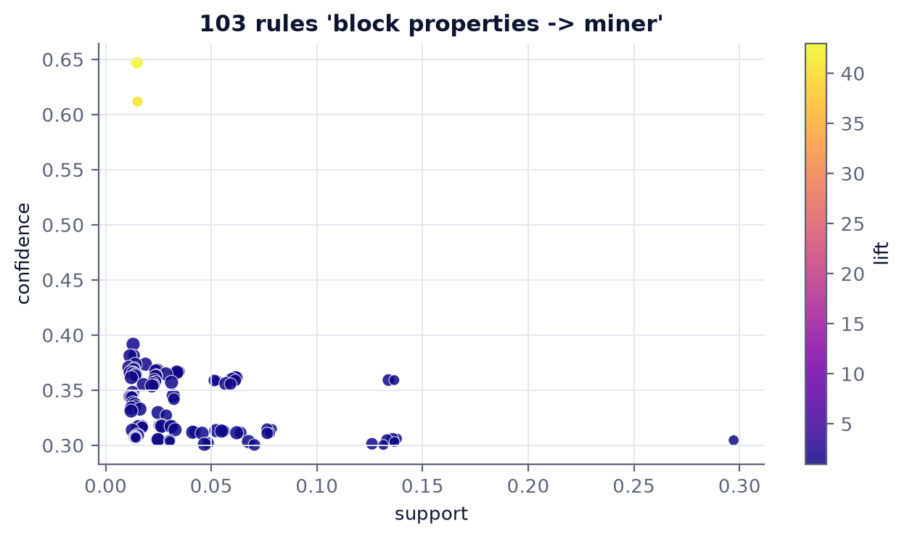

## Pool signatures and the solo contrast

Small pools can never pass a global support threshold, so we also mined frequent itemsets **inside** each pool's blocks
and compared their support with all other blocks (contrast mining):

| Pool | Signature itemset | In pool | Elsewhere | Ratio |
| :--- | :--- | ---: | ---: | ---: |
| SBI Crypto | fullness=full(>=98%) ∧ version=rolls 1-4 bits ∧ version=signal bits set | 51% | 0.3% | 175.4× |
| Braiins Pool | fullness=full(>=98%) ∧ version=signal bits set | 39% | 1.7% | 23.6× |
| MARA Pool | fullness=full(>=98%) ∧ version=rolls 5-8 bits | 62% | 36.3% | 1.7× |
| ViaBTC | fullness=full(>=98%) ∧ version=rolls 1-4 bits | 49% | 33.4% | 1.5× |
| Binance Pool | version=rolls 1-4 bits | 48% | 35.5% | 1.3× |
| CloverPool | version=rolls 1-4 bits | 47% | 36.0% | 1.3× |
| Foundry USA | fullness=full(>=98%) ∧ version=rolls 5-8 bits | 44% | 34.3% | 1.3× |
| SECPOOL | fullness=full(>=98%) ∧ version=rolls 1-4 bits | 45% | 35.1% | 1.3× |

Pools with a strong signature (signal bits, distinctive version rolling) are exactly the ones the classifier recognises
best. The large pools (AntPool, F2Pool, Luxor, SpiderPool) have **no distinctive itemset at
all**: they build blocks the way everybody else does. For the 85 solo blocks since 2019, the most
over-represented itemset (txcount=below-day-median ∧ shape=consolidating) is only
1.24× more common than among pool blocks, confirming that modern solo blocks are
nearly indistinguishable from pool blocks.

# 11. Decision making on new examples

## Unattributed blocks and real concentration

In the last 12 months before the freeze, 92 of 52,360 blocks (0.18%) carried
no attribution. The frozen model attributes them as Other pools: 68, Braiins Pool: 13, ViaBTC: 4, Foundry USA: 3.
By pool *name*, **3 entities** mined more than half of the blocks (the Nakamoto coefficient). As
an **upper-bound scenario**, if every fingerprint family of section 9.2 were a single block builder, the number would
be **1** (largest family: AntPool + Braiins Pool + Foundry USA + Luxor). Similarity is not proof of shared
ownership (family merges come from fingerprint similarity (section 9), which suggests but does not prove common control; shared templates can also come from shared software or proxy arrangements), so the true figure lies between these two bounds; the point is that pool names alone
cannot establish how decentralised block building is.

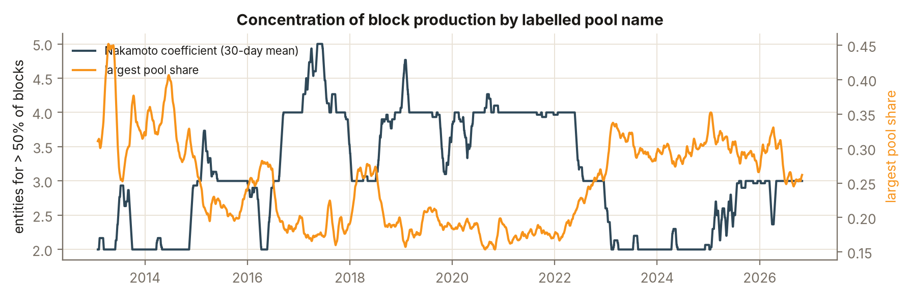

## Blocks mined after the data freeze

The 1,446 labelled blocks mined between 2026-11-01 and 2026-11-12 were never seen by any stage.
The frozen model predicted their miner first; when the labels were revealed, **36.1%** were correct,
below the test-period accuracy (42%): one more sign of drift, as pools such as SpiderPool keep growing
after the training period. The command `uv run hashatlas predict --heights …` repeats this for any block.

## The miner advisor: pool, solo lottery, or switch off?

At the freeze (30-day means to 2026-10-31): network hash rate 1,032 EH/s, BTC price
82,285 USD, **hash price 0.0380 USD per TH/s per day**. For a device with
hash rate h (TH/s) and power W, pool income = hash price × h × (1 − 2% fee), electricity = W/1000 × 24 × price per kWh,
and solo blocks arrive as a Poisson process with rate (h / network) × 144 per day.

| Device | HK pool income / day | HK electricity / day | Profit / day | Break-even USD/kWh | Solo odds / year |
| :--- | ---: | ---: | ---: | ---: | ---: |
| Bitaxe-class home miner | 0.04 | 0.08 | -0.03 | 0.103 | 1 in 16,362 |
| Antminer S19j Pro | 3.87 | 12.89 | -9.02 | 0.053 | 1 in 189 |
| Antminer S21 | 7.44 | 14.70 | -7.26 | 0.089 | 1 in 99 |
| Antminer S21 XP Hyd | 17.59 | 23.84 | -6.25 | 0.129 | 1 in 42 |

Hong Kong business electricity costs 0.175 USD/kWh; an Antminer S21 needs
**0.089 USD/kWh or less**. Among the 26 economies with business tariffs in our snapshot, the S21 covers its
electricity in 6: Bhutan, Ethiopia, Paraguay, Indonesia, Vietnam, Kazakhstan.

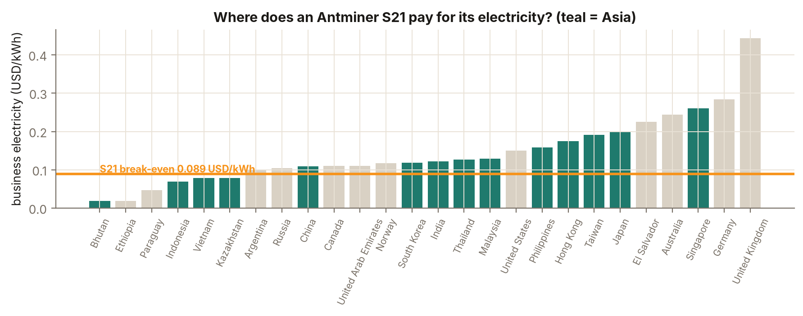

**Decision.** In Hong Kong, at retail tariffs, mining for profit does not pay at the freeze-date hash price. A small
home miner (1.2 TH/s) is a lottery ticket: odds of about **1 in 16,362 per year**, an
expected wait of 16,361 years, and it costs electricity every day it runs. The
advisor recommends pool mining only where electricity is below the device's break-even price, and labels solo mining
honestly as a lottery.

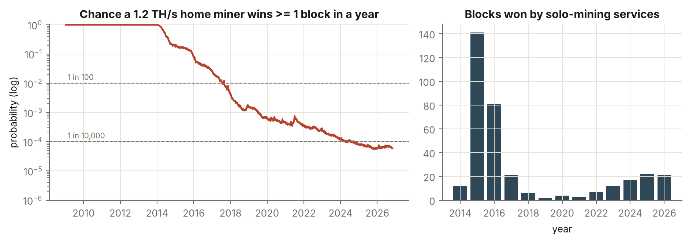

# 12. Future Lab: the 2028 halving (scenarios, not forecasts)

**How much future, and how.** We include the future only where it can be grounded: (1) the protocol schedule is
certain: the subsidy halves at height 1,050,000; (2) hash-rate growth is simulated by block-bootstrapping
30-day stretches of historical daily growth (4,000 paths); (3) BTC price and fee share are **user-chosen
scenarios**, never forecasts; (4) the method is **backtested** from four historical dates.

* Projected halving date: **2028-04-07** (80% of paths 2028-04-04 → 2028-04-09).
* Backtest (16 origin/horizon cases): the 80% band contained the realised hash rate in **75%** of
  cases. Two resampling windows were compared by the declared rule "lower backtest error wins": mean |error| of the
  median path 50% (last 3 years) vs 72% (since
  2017), so the last-3-years window drives the main scenario. **Honest limitation:** a naive "no growth" projection had
  a lower error (28%) over 2019-2025, so the median path should be read as one point in a wide
  range, not as a prediction.

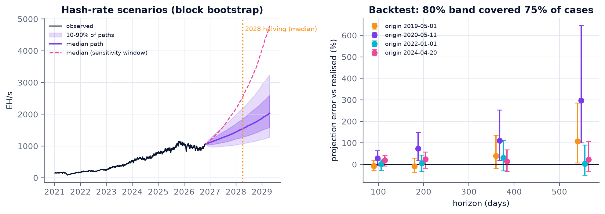

| Device | Checkpoint | Date | Break-even USD/kWh (p10-p90) | Solo odds / year |
| :--- | :--- | :--- | ---: | ---: |
| Bitaxe-class home miner | 2027-01-01 | 2027-01-01 | 0.096 (0.086-0.108) | 1 in 17,607 |
| Bitaxe-class home miner | one month after halving | 2028-05-07 | 0.034 (0.023-0.049) | 1 in 25,114 |
| Bitaxe-class home miner | 2029-01-01 | 2029-01-01 | 0.029 (0.018-0.044) | 1 in 29,793 |
| Antminer S21 | 2027-01-01 | 2027-01-01 | 0.082 (0.074-0.093) | 1 in 106 |
| Antminer S21 | one month after halving | 2028-05-07 | 0.029 (0.020-0.042) | 1 in 151 |
| Antminer S21 | 2029-01-01 | 2029-01-01 | 0.024 (0.016-0.038) | 1 in 179 |
| Antminer S21 XP Hyd | 2027-01-01 | 2027-01-01 | 0.120 (0.107-0.136) | 1 in 45 |
| Antminer S21 XP Hyd | one month after halving | 2028-05-07 | 0.042 (0.029-0.061) | 1 in 64 |
| Antminer S21 XP Hyd | 2029-01-01 | 2029-01-01 | 0.036 (0.023-0.055) | 1 in 76 |

At today's price and a 5% fee share, the halving cuts the break-even electricity price of every device by more than half
(Antminer S21: 0.082 → 0.029 USD/kWh).
Break-even scales linearly with price, so even a doubled BTC price would only restore it to about
0.058 USD/kWh. After 2028, mining is viable only at very cheap,
mostly industrial or stranded power, consistent with how mining migrated after earlier halvings. The dashboard's
Future Lab lets the reader test any price and fee scenario.

# 13. Interpretation and critical evaluation

**Q1: Can fingerprints identify the miner?** Partly. The decision tree clearly beats every baseline and puts the
true pool in its top three 69% of the time; pools with distinctive version-bit habits or
signalling are recognised well. Most large pools, however, build blocks the same way, so exact-pool accuracy is capped
at about 42%. The cap is informative rather than a failure: contrast mining finds no distinctive
signature for the largest pools, and newcomer pools are mapped onto existing templates. Modern solo blocks are largely
indistinguishable from pool blocks.

**Q2: Eras and families.** The unsupervised eras match documented history (ARI 0.89 with
Ward), and the pool families explain the classifier's confusions.

**Q3: Should a small miner mine?** In Hong Kong, for profit, no; for fun, it is a lottery ticket with known odds. After
the 2028 halving the economics tighten further for everyone.

**Limitations.** (1) Labels are self-declared and may be copied or shared; mempool.space's attribution is the
reference for 2019+. (2) Fingerprints drift; the model is dated to its training period and must be retrained. (3)
"Other pools" is a heterogeneous class. (4) Solo results rest on a few dozen blocks. (5) Electricity prices are retail
snapshots; industrial miners pay less, and prices change. (6) The Future Lab is conditional on its assumptions and its
backtest error is large. (7) Family similarity is not proof of common ownership.

# 14. Ethics and practical implications

* **Privacy.** Blocks are public and pseudonymous; no personal data is used. Fingerprinting miners is dual-use: it can
  support decentralisation research but could also help de-anonymise solo miners. We publish aggregate findings and
  model behaviour only, and no address-level analysis.
* **No financial advice.** The advisor shows odds, costs and break-even prices; the dashboard and report state that
  outputs are historical analysis and scenarios.
* **Environment.** Break-even analysis shows why mining concentrates where power is cheap; the energy-efficiency
  frontier (J/TH) fell about a millionfold from CPUs to ASICs, but total consumption is outside our scope.
* **Implications.** Pool names overstate decentralisation; regulators and analysts should look at *template* diversity.
  For individuals in high-tariff economies like Hong Kong, home mining is entertainment, not income.

# 15. AI-agent use and verification

The team used AI coding agents (see `agent_trajectories/`) following the course's workflow: humans defined the
problem and constraints; the agent proposed plans; humans reviewed them; the agent implemented; humans verified
outputs; then revised. Examples where human review changed the agent's output:

* An early class design scored macro-F1 over *all* classes, including pools that had stopped mining; reviewers changed
  it to classes present in the evaluation period (predicting a vanished pool is still an error).
* The first association-rule run produced **zero rules** because a 50% confidence threshold ignored base rates of 1-30%;
  the threshold was set from base rates and per-pool contrast mining was added.
* The first Future Lab method overshot hash-rate growth in its own backtest; the resampling window is now chosen by
  backtest error, and the remaining weakness is reported.
* When the free data quota ran out mid-download, the agent's retry loop kept failing silently (HTTP 402); the team
  switched the 2019+ era to mempool.space and added a completeness check (no missing heights).

**Independent verification** (`uv run hashatlas verify`) recomputes key results through separate code paths:
**17 of 17 checks passed**.

| Check | Result |
| :--- | :--- |
| test macro-F1 from saved predictions | pass |
| test accuracy from saved predictions | pass |
| confusion matrix sums to test blocks | pass |
| no label-source / time features in model | pass |
| train < validation < test < new (no overlap) | pass |
| model choice frozen before test evaluation | pass |
| root split Gini reduction | pass |
| exported tree (web simulator) == fitted tree | pass |
| transactions count | pass |
| Apriori brute-force check (stage) passed | pass |
| top rule confidence | pass |
| hash price (USD/TH/day) on freeze day | pass |
| subsidy follows 50 BTC / 2^(height // 210000) | pass |
| solo P(block in a year), Bitaxe | pass |
| tag labeller precision >= 99% when a tag is found | pass |
| no missing or duplicate heights | pass |
| web models.json matches test metrics | pass |

Unit tests (`uv run pytest`) cover bit decomposition, leakage exclusions, day-relative features, Apriori against brute
force, impurity measures, miner economics and the bootstrap; the dashboard has its own tests and a browser check.

# 16. Conclusion

A small Bitcoin miner can still win, but only as a lottery: the odds have fallen from near-certainty in 2009 to about
1 in 16,362 per year for a 1.2 TH/s device today, and they will roughly halve again in value
after April 2028. Data mining on 975,494 blocks shows *why* the industry looks the way it does: the eras are visible in
the data, pool names hide fewer distinct block builders, and behavioural fingerprints narrow a block down to a few look-alike
pools. Future work: per-transaction template features, Stratum V2 adoption (which lets miners build their
own templates and may change fingerprints), and live retraining.

# 17. Team members and contributions

Each member was primarily responsible for specific components of the project while maintaining continuous
collaboration and consultation throughout development. The workload was distributed as evenly as possible across the
group, with the captain undertaking a slightly larger share of the core technical implementation, system integration,
deployment, and final production tasks.

Responsibilities were divided by stage of the data-mining lifecycle rather than by deliverable, so that the same
person owns a stage end to end: its code module, its page on the dashboard, its sections of this report, its slides
in the presentation and its record of AI-agent use. This kept every part of the project traceable to one accountable
owner, while the hand-over points between stages (the cleaned block table, the frozen feature list, the frozen model,
the cluster and rule outputs, and the dashboard data export) were agreed jointly and reviewed by the next owner in the
pipeline before work continued.

| Member | Role (report sections) | Contributions and code |
| :--- | :--- | :--- |
| LO Chi Kong (4672784) | Captain: problem definition, data engineering, integration and delivery (§1-4, 16-18 (and final compilation)) | Defined the miner-decision problem, users, constraints and alternative solutions; Built acquisition of 6,500+ daily block dumps, pool definitions, solo lists, network charts and electricity prices with SHA-256 provenance; Cleaned and labelled 975k blocks; wrote the data dictionary, quality checks and label audit; Integrated the pipeline (configuration, CLI, run-all), the report build, the dashboard shell and theme, deployment and the introduction video; compiled the final report and submission. Code: `src/hashatlas/config.py, cli.py, acquire.py, clean.py, report.py; configs/; web/src/App.tsx, styles.css, pages/Overview.tsx, pages/Methods.tsx; presentation/video/` |
| POON Tsz Chun ([student ID]) | Feature transformation, feature selection and model learning (§5-7) | Designed the fingerprint features (version/nonce bit decomposition, body ratios, day-relative policy) and the leakage exclusions; Ran feature selection: variance filter, mutual information against noise probes, Spearman redundancy and group ablation; Tuned the decision tree, KNN and linear/RBF SVM with month-grouped and nested cross-validation; froze the model choice before testing. Code: `src/hashatlas/features.py, train.py; web/src/pages/Simulator.tsx, lib/tree.ts` |
| SUBEDI Anukaran ([student ID]) | Performance evaluation, model explanation and decisions on new blocks (§8, 11 (unattributed and post-freeze blocks)) | Evaluated the frozen models on the sealed 2025-26 test period: macro-F1, confusion, ROC/PR, day-block bootstrap and drift; Explained the tree (worked Gini split, permutation importance) and mapped newcomer pools to their nearest template; Applied the frozen model to unattributed blocks and to blocks mined after the data freeze; produced the report figures. Code: `src/hashatlas/evaluate.py, explain.py, predict.py, figures.py; web/src/pages/Radar.tsx` |
| YE Xiaochen ([student ID]) | Clustering, association rules and independent verification (§9, 10, 13) | Rediscovered the mining eras with K-means, four hierarchical linkages and DBSCAN; built pool families by dendrogram; Implemented Apriori from scratch with brute-force verification, rule confirmation on a later window and the solo contrast; Wrote the independent verification checks and the unit-test suite; led the interpretation and limitations review. Code: `src/hashatlas/clusters.py, rules.py, verify.py; tests/; web/src/pages/Eras.tsx, Rules.tsx` |
| LO Ka Hung ([student ID]) | Decision support, Future Lab, dashboard data and ethics (§11 (miner advisor), 12, 14) | Built the miner advisor: pool vs solo vs switch off across devices and 27 economies; Built the Future Lab: block-bootstrap hash-rate scenarios, 2028 halving timing and the historical backtest; Exported the dashboard data, built the Advisor and Future Lab pages and ran the live demo; led the ethics review. Code: `src/hashatlas/decide.py, future.py, webdata.py; web/src/pages/Advisor.tsx, Future.tsx, lib/econ.ts` |

| Member | Dashboard page | Slides presented |
| :--- | :--- | :--- |
| LO Chi Kong (captain) | Overview, Methods & Data, site shell and deployment | Title, introduction video, questions, problem, data, conclusion |
| POON Tsz Chun | Fingerprint Lab | Features, feature selection, validation design |
| SUBEDI Anukaran | Block Radar | Sealed-test results, confusion and newcomers, blocks after the freeze |
| YE Xiaochen | Eras & Families, Pattern Miner | Mining eras, pool families and rules, limits and verification |
| LO Ka Hung | Miner Advisor, Future Lab | Miner advisor, live demo, Future Lab |

Collaboration did not stop at these boundaries. Problem framing, the choice of questions and the evaluation design
were decided by the whole group; each owner's agent-generated code and results were checked by at least one other
member before they were merged; and the conclusions, limitations and presentation were rehearsed and revised together.
Each member's individual work is also visible in the Git history of the repository and in their own exported
AI-agent trajectory (Section 15).

# 18. Reproducibility and references

**Run.** `uv sync`, then `uv run hashatlas run-all` (Python 3.12, versions locked in `uv.lock`); dashboard:
`cd web && bun install && bun run build`. Repository: https://github.com/ORGANISATION/REPOSITORY. Live dashboard: <https://cds3004.ansonlo.dev/>.

**Data sources.** Blockchair daily block dumps (blockchair.com/dumps); mempool.space REST API and the open
`mempool/mining-pools` definitions; blockchain.com chart API; GlobalPetrolPrices electricity prices (snapshot
retrieved 2026-11-12). Hardware specifications are manufacturer figures (approximate).

**Methods.** Course lectures 2-10 (CDS3004, Lingnan University); scikit-learn user guide (trees, KNN, SVM, clustering,
model selection); Nakamoto, S. (2008) *Bitcoin: A Peer-to-Peer Electronic Cash System*; BIP 9 and BIP 320 (version-bit
signalling and general-purpose version bits).
